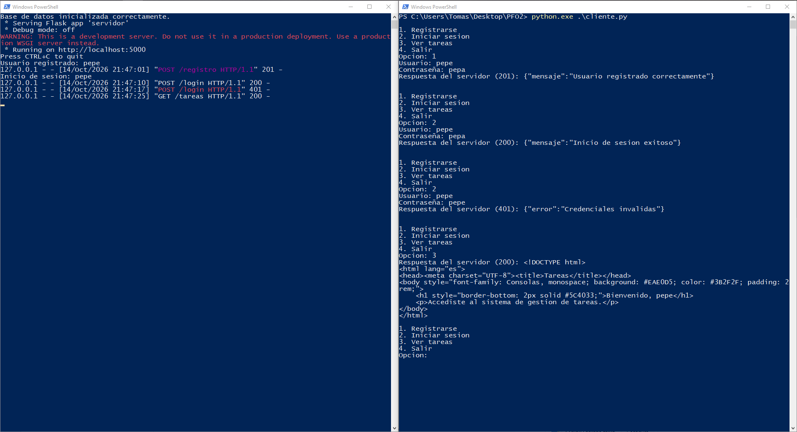

# PFO 2 - Sistema de Gestión de Tareas con API y Base de Datos

**Estudiante:** Tomás Julián Resquín  
**Materia:** Programación sobre redes - 3° D

## Ejecución

Requiere Python 3 con Flask y requests:

```bash
pip install flask requests
```

1. Iniciar el servidor (escucha en `http://localhost:5000` y crea `tareas.db`):
   ```bash
   python servidor.py
   ```
2. En otra terminal, iniciar el cliente:
   ```bash
   python cliente.py
   ```

## Prueba

Desde el cliente:

1. **Registrarse** → `POST /registro` responde `201`.
2. **Iniciar sesión** → `POST /login` responde `200` (con una contraseña incorrecta responde `401`).
3. **Ver tareas** → `GET /tareas` devuelve el HTML de bienvenida. Sin haber iniciado sesión responde `401`.

| Método | Endpoint | Descripción |
|---|---|---|
| POST | `/registro` | Recibe `{"usuario": "nombre", "contraseña": "1234"}` y guarda el usuario con la contraseña hasheada. |
| POST | `/login` | Verifica las credenciales e inicia la sesión. |
| GET | `/tareas` | Muestra un HTML de bienvenida (requiere sesión iniciada). |

## Capturas



## Respuestas conceptuales

**¿Por qué hashear contraseñas?**  
Para que, si alguien accede a la base de datos, no pueda leer las contraseñas. El hash es de una sola vía: no se puede revertir para obtener la contraseña original. Al iniciar sesión, el servidor hashea la contraseña ingresada y la compara con el hash guardado. Además, `werkzeug` agrega una sal aleatoria, por lo que dos usuarios con la misma contraseña tienen hashes distintos.

**Ventajas de usar SQLite en este proyecto**  
No necesita instalar ni configurar un servidor de base de datos: viene incluido en Python (`sqlite3`) y guarda todo en un único archivo (`tareas.db`). Esto hace que el proyecto sea fácil de ejecutar, mover y probar. Para una aplicación chica como esta, alcanza de sobra.
